<!--

author:   André Dietrich; Jihad Hyadi

version:  1.5.0

language: en

comment:  edrys-lite Documentation

icon:     images/logo.png

narrator: UK English Female

-->

# edrys-lite Documentation

Welcome to the edrys-lite documentation!

    --{{0}}--
edrys-lite provides an intuitive and simple way for users to engage with laboratory environments directly from their browser -- nearly no servers required.
This documentation will guide you through the process of creating and managing interactive classrooms, developing modules, and exploring the various features of edrys-lite.
!?[](videos/edrys_01-0.webm)

- 📖 Use the contents below to get started
- 💬 For questions and discussions, please visit our
  [Gitter community](https://gitter.im/edrys-org/community)
- 🐞 For bug reports and feature requests, visit the
  [issues tab](https://github.com/edrys-labs/edrys-lite/issues)
- [](https://liascript.github.io/course/?https://raw.githubusercontent.com/edrys-labs/documentation/refs/heads/main/README.md)


## Contents

    --{{0}}--
The first parts of this documentation are for everyone who uses edrys-lite: teachers who set up a classroom and students who join one.
Background on how edrys-lite works under the hood, and a guide for developers who want to build their own modules, follow at the end.

**Using edrys-lite**

1. [Getting Started](#Getting-Started)
2. [Setting up a Classroom](#Setting-up-a-Classroom)
3. [Working in a Classroom](#Working-in-a-Classroom)
4. [Remote Labs with Stations](#Remote-Labs-with-Stations)
5. [AI Agents and Skills](#AI-Agents-and-Skills)
6. [Privacy and Security](#Privacy-and-Security)
7. [Troubleshooting](#Troubleshooting)

**Background and Development**

8. [How edrys-lite Works](#How-edrys-lite-Works)
9. [Developing Modules](#Developing-Modules)

**Help**

10. [Reporting Issues](#Reporting-Issues)


## Getting Started

    --{{0}}--
Based on [edrys](https://github.com/edrys-org/edrys), edrys-lite is a lightweight, browser-based implementation designed for remote labs and classrooms.
It enables seamless collaboration by allowing users to create and interact with various modules such as textual and graphical editors, terminals, camera streams, and drawing tools.
The modular architecture ensures that each module operates as an independent entity, making it configurable and reusable across different educational and experimental contexts.
!?[](videos/edrys_03-0.webm)

    --{{0}}--
There is no account to create and nothing to install.
A classroom lives in the browsers of the people who use it, and everyone connects directly to each other.
All you need is a modern browser and the link to a classroom.

- No sign-up, no password, no installation
- Works in Chrome, Edge, Firefox and Safari
- Classrooms are made of _modules_: editors, terminals, camera streams, task descriptions, ...
- Remote hardware (e.g. an Arduino) can be shared with students through _stations_

!?[YouTube Demo](https://www.youtube.com/watch?v=6ZjGHorc2ds)

### Roles

    --{{0}}--
Everyone in a classroom has one of the following roles. Your role is shown by the icon next to your name in the room list.

| Role        | What they can do                                                                                                   |
| ----------- | ------------------------------------------------------------------------------------------------------------------ |
| **Teacher** | Configure the classroom: settings, modules, members, stations. The creator of a classroom is its _owner_ and always a teacher. |
| **Student** | Join rooms, work with the modules and collaborate with others.                                                     |
| **Station** | A browser left running on a device (e.g. a PC connected to lab hardware) that shows up as its own room.            |
| **Visitor** | Someone who opened the link of a classroom that only admits listed students. Visitors can watch, but cannot change anything. |

    --{{1}}--
With its browser-native design, edrys-lite provides an accessible and efficient platform for collaborative learning, leveraging modern web technologies to facilitate real-time interaction between students, teachers, and hardware-enabled stations.

### Your User ID

    --{{0}}--
The first time you open edrys-lite, your browser creates a personal key pair for you.
The public part of this key is your **User ID**. It identifies you in every classroom, and teachers use it to add you as a teacher or student.

    --{{0}}--
To find your User ID, open the menu with the three dots (⋮) in the top right corner.
A short version of the ID is shown there; the copy button next to it copies the full ID, which is what a teacher needs.

<section>

- Your ID is tied to **this browser**. Another browser, another device, or a private window gives you a different ID.
- Clearing the site data of your browser deletes your ID and the classrooms stored in it. Download a backup of your classrooms first (see [Backup, Restore and Templates](#Backup%2C-Restore-and-Templates)).
- The same menu also lets you switch the language of the interface and the theme: `Light`, `Dark`, or `System` to follow your device.

</section>

### Creating a Classroom

*    --{{0}}--
  Visit https://edrys-labs.github.io and click on `Create a class`.
  By the way, the buttons in the footer allow you to have a look at the project on GitHub, read this documentation, explore several ready-to-use remote labs and visit the blog.
  The menu with the three dots (⋮) in the top right corner holds your User ID, the language and the theme.

  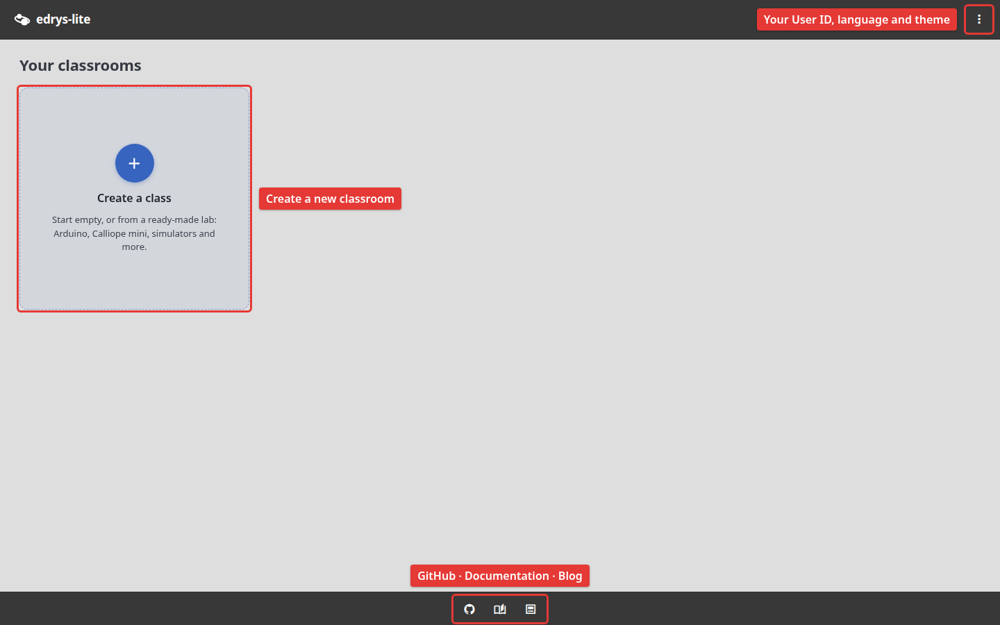

*    --{{0}}--
  A new classroom will be generated with a unique ID in the URL, and you are its owner.
  Every new classroom starts with a **welcome guide** in the Lobby, which walks you through the first steps of the setup.
  It is an ordinary Markdown module, so you can edit or delete it at any time in `Settings` → `Modules`.

  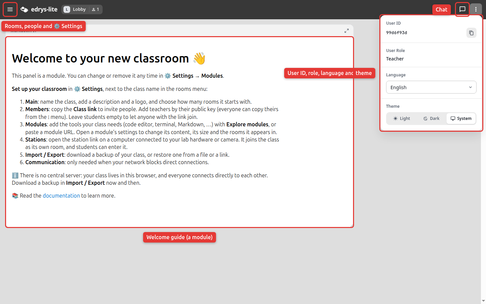

*    --{{0}}--
  The button in the top left corner (☰) opens the rooms menu. It lists the rooms and the people in them, and the ⚙️ `Settings` button next to the class name.
  While the menu is closed, the top bar shows the room you are in and how many people are there.

*    --{{0}}--
  Students who open the classroom before you have set it up see a short note asking them to come back later.

### Inviting People

    --{{0}}--
To invite people, send them the classroom link.
You find it as `Class link` at the top of `Settings` → `Members`, with buttons to copy it or to open it in a new tab. It is the same link as in your browser's address bar.

```
https://edrys-labs.github.io/?/classroom/<classroom-id>/<owner>
```

    --{{0}}--
The last part of the link identifies you as the owner of the classroom.
Whoever opens the link for the first time uses it to check that the classroom setup they receive really comes from you, so always share the full link.

    --{{0}}--
By default, everyone with the link can join as a student.
If you want to restrict who may take part, add your students to the members list (see [Members](#Members)).

    --{{0}}--
Every classroom you created or joined is listed on the start page under `Your classrooms`, so you can come back to it later.
Each card shows whether you own the class or take part as a teacher or student. From there you can open it again, fork it (make your own copy), or delete it from your browser.
A class without a logo gets a generated picture, so the cards are easy to tell apart.

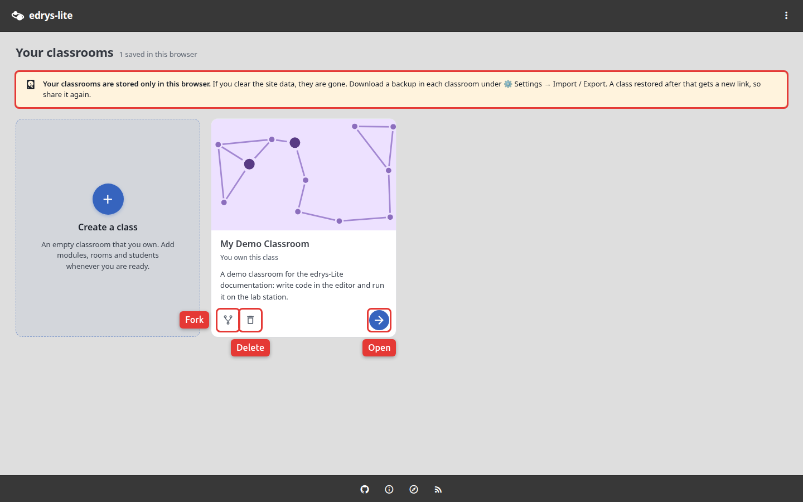

    --{{0}}--
The note above the cards is a reminder that your classrooms are stored only in this browser (see [Backup, Restore and Templates](#Backup%2C-Restore-and-Templates)).


## Setting up a Classroom

    --{{0}}--
Teachers configure the classroom through the ⚙️ `Settings` button next to the class name in the rooms menu (☰).
The settings are split into the tabs Main, Members, Modules, Stations, Import / Export and Communication.
Changes are applied to everyone in the classroom as soon as you click `Save`. Until then, `Unsaved changes` is shown next to the button.

### Main Settings

    --{{0}}--
In the Main tab you can give your classroom a name and a description, and optionally the URL of a logo.
If you leave the logo empty, the class keeps its generated picture.
The preview next to the fields shows how the class appears on the start page.

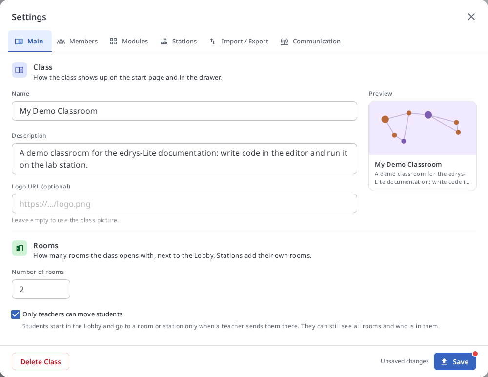

    --{{0}}--
The number of rooms defines how many numbered rooms (Room 1, Room 2, ...) the classroom opens with next to the Lobby. Stations add their own rooms on top.

<section>

- Raising the number adds the new rooms as soon as you save.
- Lowering it removes the rooms above the new number. People in a removed room are moved back to the Lobby.
- A classroom can have up to 50 rooms.
- The owner can also add a room with the `New room` button at the bottom of the room list.

</section>

### Members

    --{{0}}--
In the Members tab you decide who teaches and who may take part.
At the top you find the `Class link` to send to your class (see [Inviting People](#Inviting-People)).
Below, members are added by their User ID (see [Your User ID](#Your-User-ID)), separated by commas.

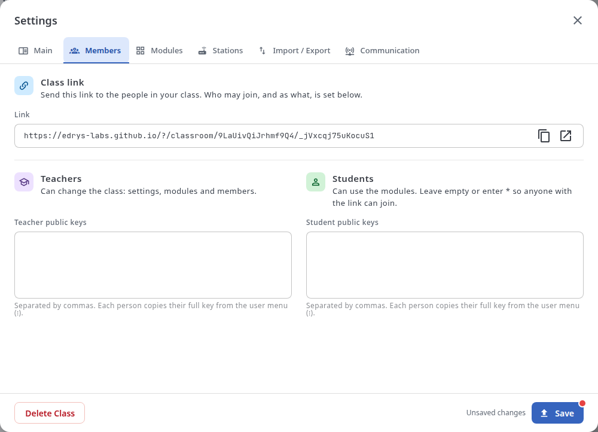

    --{{0}}--
Teachers get access to the settings, so they can change the classroom just like you: its settings, modules and members.
The student list works as follows:

<section>

| Student list             | Who can take part                                                                                             |
| ------------------------ | ------------------------------------------------------------------------------------------------------------- |
| empty, or contains `*`   | Everyone with the classroom link joins as a student.                                                          |
| a list of User IDs       | Only these students (and the teachers) can take part. Everyone else who opens the link becomes a **visitor**. |

</section>

    --{{0}}--
Visitors can follow what happens in the classroom, but whatever they write, send or change is ignored by everybody else.
The members list is checked by every participant's browser, not by a server, so it cannot be bypassed by a modified client.

### Adding Modules

    --{{0}}--
Modules are the building blocks of a classroom: task descriptions, code editors, terminals, camera streams and much more.
Open `Settings` → `Modules` to add them.

    --{{1}}--
Click on `Explore modules` to open the Modules Explorer, and add a module to the classroom with its `Add` button.
The most frequently used modules are listed first; the ⓘ button leads to a module's github repository.

      {{1}}
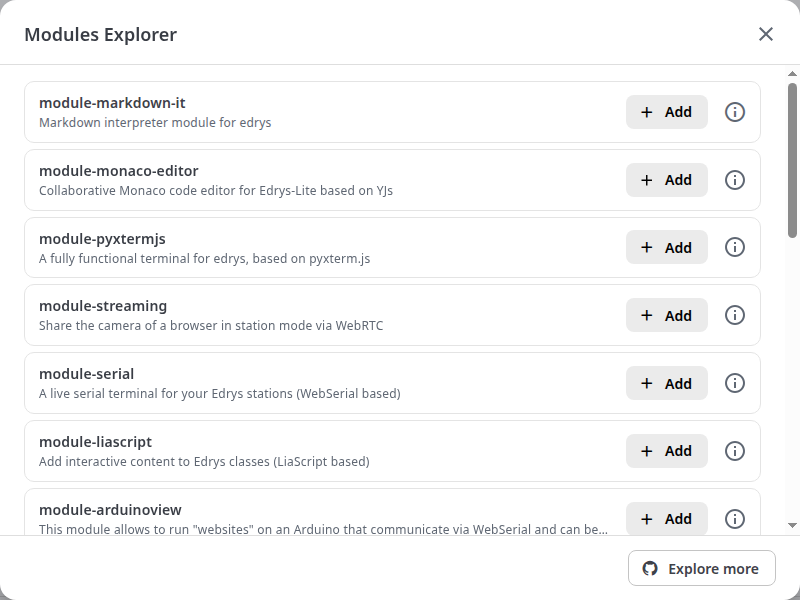

    --{{2}}--
For more modules, click on `Explore more` at the bottom of the Explorer to see a list of all modules.
Every module comes with a description of its configuration and an __include URL__.
You can copy the URL of a module, paste it into the `Module URL` field and click `Add`.

      {{2}}
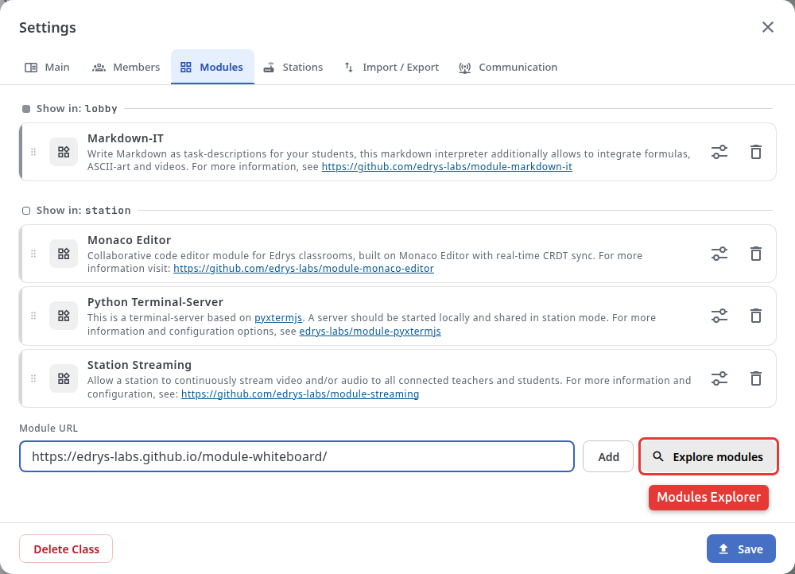

    --{{3}}--
Some of the most used edrys modules are:

      {{3}}
- [Markdown-IT](https://github.com/edrys-labs/module-markdown-it): Task descriptions and instructions written in Markdown.
- [Code Editor](https://github.com/edrys-labs/module-monaco-editor): A collaborative code editor that supports multiple languages.
- [PyxTerm.js Terminal](https://github.com/edrys-labs/module-pyxtermjs): A terminal on a station, e.g. to compile and upload the code from the editor.
- [Video Stream](https://github.com/edrys-labs/module-streaming): Streams a camera from a station to the students.
- More modules can be found at: https://github.com/topics/edrys-module

### Configuring Modules

    --{{0}}--
Click on the settings button (the sliders icon) next to a module to configure it.
The dialog has two parts: `Module Configuration` and `Advanced (raw config)`.

    --{{0}}--
Many modules provide a configuration form under `Module Configuration`, with fields, checkboxes and drop-down lists.
Some drop-down lists are presets: picking one fills in the fields below it with suitable values, which you can then adjust.

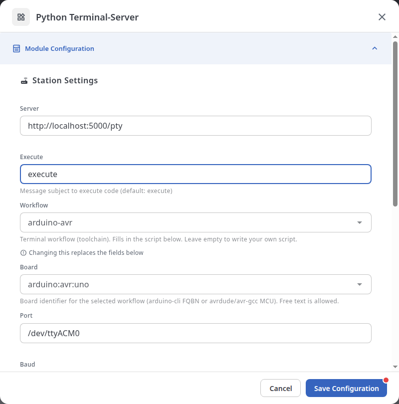

    --{{0}}--
Under `Advanced (raw config)`, every part of the module has its own row, with a summary of its current value: the module `URL`, its `Design` (width and height), its settings as YAML or JSON, and `Show in`, the rooms it appears in.
Click on a row to open it.

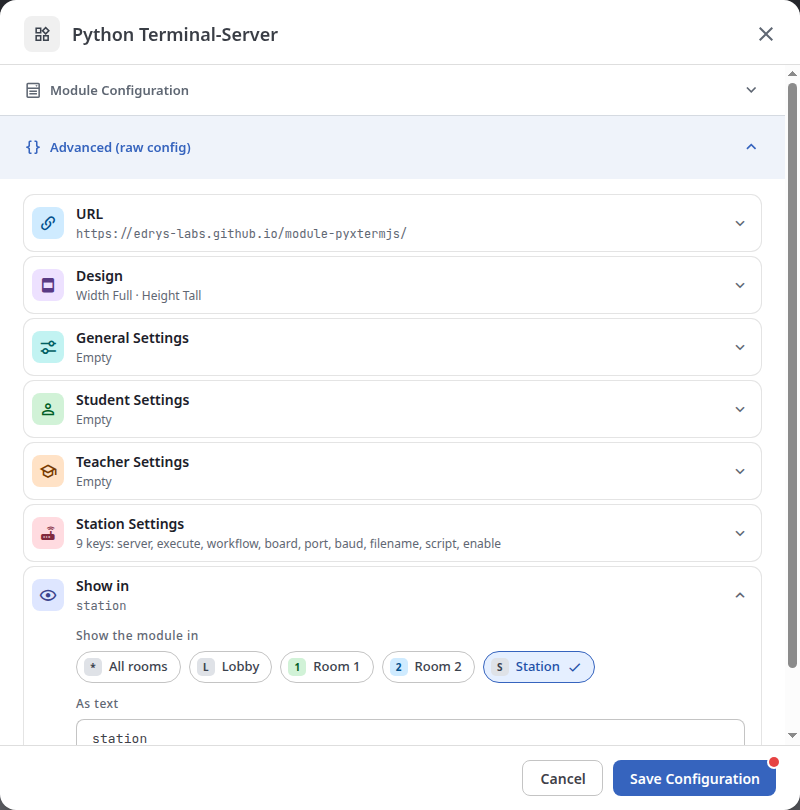

    --{{0}}--
Settings can be given for everyone (`General Settings`), or separately for students, teachers and stations.
If a module's configuration contains an error, the module shows `Module configuration has errors` in the list.
Click `Save Configuration` to close the dialog, and `Save` in the settings to apply the changes.

    --{{0}}--
You can drag and drop modules to rearrange them. In the list, modules are grouped by the rooms they appear in.

#### Show in

    --{{0}}--
`Show in` decides in which rooms a module appears.
The buttons `All rooms`, `Lobby`, one per room and `Station` switch the places on and off.
Below them, the `As text` field shows the same as a comma separated list, which you can also edit by hand. It accepts the following entries:

<section>

| Entry          | Shows the module in                                     |
| -------------- | ------------------------------------------------------- |
| `*`            | every room (default)                                    |
| `lobby`        | the Lobby                                               |
| `station`      | every station room                                      |
| `Room 1`       | exactly this room (`Room 1` does not include `Room 10`) |
| `Room *`       | every room whose name starts with `Room `               |
| `teacher-only` | combined with the above: only for teachers              |
| `station-only` | combined with the above: only on the station itself     |

</section>

    --{{1}}--
For example, `lobby, Room 1, Room 2` shows a module in the Lobby and the first two rooms, and `station, station-only` shows it only to the station device, e.g. for a hardware connection that students should not see.
`teacher-only` and `station-only` have no button; type them into the text field.
If no module is configured for a room, the room shows a short note instead.


### Backup, Restore and Templates

    --{{0}}--
There is no central server that stores your classroom: it lives in your browser and in the browsers of the people who use it.
Open `Settings` → `Import / Export` to download a backup of your classroom, or to restore one.
Download a backup now and then, and always before you clear your browser data.
If you have to restore a class after that, create a new class and restore the backup into it. The new class has a new link, so share it again.

      {{1}}
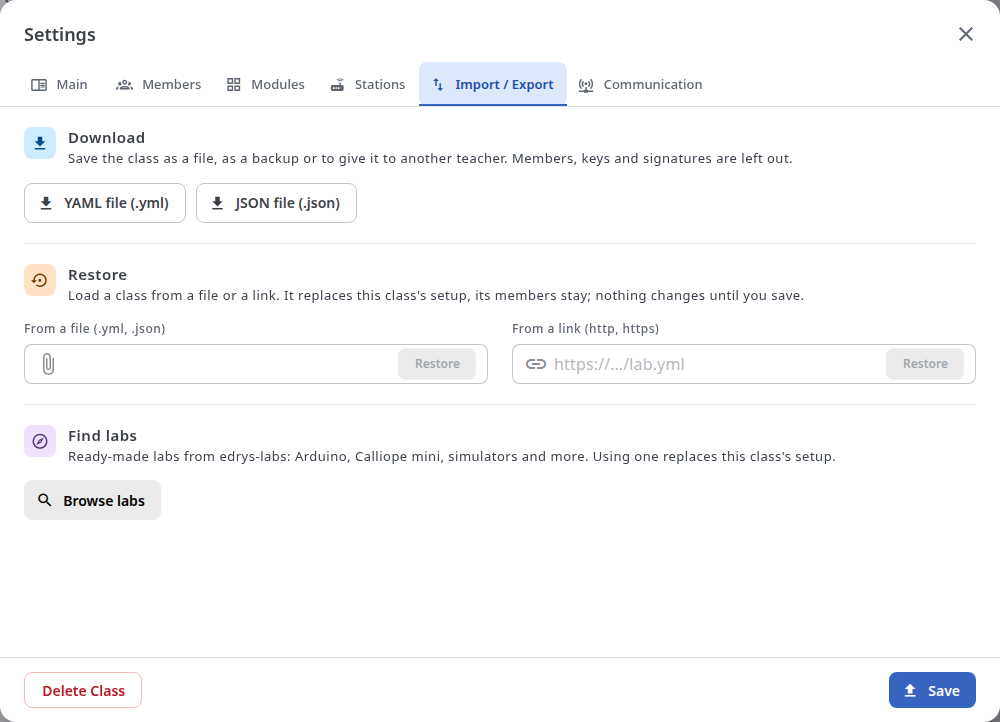

    --{{2}}--
Under `Download` you can save the configuration as a YAML or JSON file, whereby we prefer YAML for its better readability.
The result looks similar to the following example, which can be modified manually or shared with others.

     {{2}}
```yaml
id: unique id of the lab
dateCreated: date of creation
name: name of the lab
meta:
  logo: url of the lab logo
  description: description of the lab
  defaultNumberOfRooms: number of rooms
members:
  teacher: list of teacher ids
  student: list of student ids
modules:
  - url: url of the module
    config: available for everyone
    studentConfig: available for students
    teacherConfig: available for teachers
    stationConfig: available in stations
    showInCustom: rooms in which the module will be shown
    width: full/half/third (or a custom value)
    height: huge/tall/medium/short (or a custom value)
```

    --{{2}}--
The file contains no keys or signatures.
Whoever restores it becomes the owner of the restored classroom, so a file can be shared freely as a template.

    --{{2}}--
Under `Restore` you can load a configuration either from a file on your computer or, if it is hosted somewhere on the web, from a link to the file. Click `Restore` next to it.
The loaded configuration replaces the setup of the current class, but nothing changes for the others until you click `Save`.

    --{{3}}--
Some ready-to-use classroom configurations are available in the following repositories, which `Explore on GitHub` under `Find labs` opens (you can also just click the deploy button of the desired configuration):

      {{3}}
https://github.com/topics/edrys-lab

    --{{4}}--
Deploy buttons are a shortcut to create a new classroom from a configuration file. The only relevant part is the URL of the file, which is appended to `https://edrys-labs.github.io/?/deploy/`.
This instructs edrys-lite to create a new classroom with the configuration fetched from the given URL.

      {{4}}
```markdown
[fast deploy](https://edrys-labs.github.io/?/deploy/https://raw.githubusercontent.com/edrys-labs/lab-web-serial/main/laboratory/micropython.yaml)
```

    --{{5}}--
You can try this out by yourself by clicking on the following button:

      {{5}}
[](https://edrys-labs.github.io/?/deploy/https://raw.githubusercontent.com/edrys-labs/lab-web-serial/main/laboratory/micropython.yaml)


### Communication

    --{{0}}--
By default, edrys-lite connects everyone directly to each other via WebRTC. However, under certain network conditions, such as strict firewalls or NATs at schools and universities, WebRTC may not work reliably.

    --{{1}}--
In such cases, you can switch from `WebRTC` to `Websocket` in `Settings` → `Communication`. All messages are then relayed through a WebSocket server.

    {{1}}
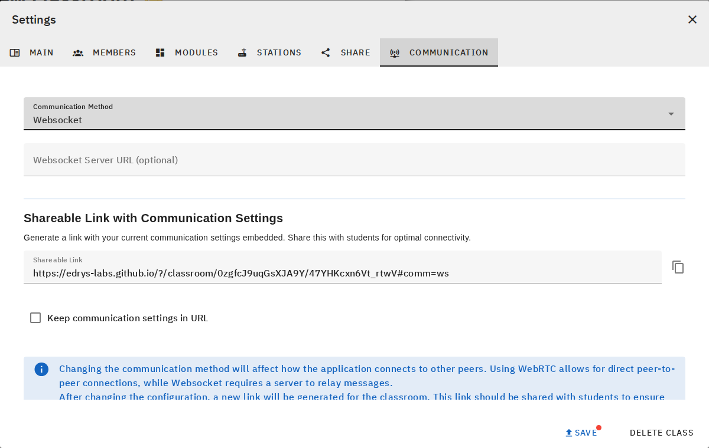

    --{{2}}--
For both methods you can optionally change the server settings, such as the signaling server and the STUN/TURN servers for WebRTC, or the WebSocket server URL. If you leave them empty, the defaults are used.

    {{2}}
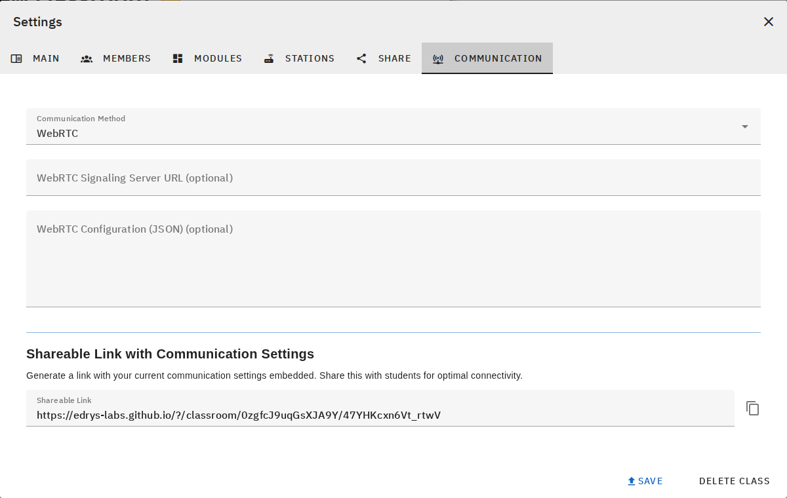

    --{{2}}--
Everyone in a classroom has to use the same settings to find each other.
The Communication tab therefore shows a `Link with these settings`; send this link to your students instead of the plain classroom link.
If you tick `Keep the settings in the address bar`, your own address bar shows this link as well. Otherwise the settings are read once and removed from the address after the class loads.


## Working in a Classroom

    --{{0}}--
Once you have joined a classroom, the rooms menu (☰, or the room name in the top bar) lists its rooms and who is in them.
Click on a room to move there. Everyone starts in the Lobby. Each room has its own color and letter, which also mark it in the top bar and in the settings.

    --{{0}}--
The modules of a room are shared by everyone in it: if one student types into an editor, the others see it right away, together with each other's cursors.
Each room has its own state, so different groups can work in different rooms without interfering.

<section>

- **Room list:** Below each room you see who is in it. You are marked with `you`, and teachers and visitors with their role; everyone else is a student. Stations have their own mark.
- **Chat:** The chat button in the top bar opens the classroom chat. A badge tells you when new messages have arrived. Messages can be formatted with Markdown.
- **Full screen:** The button in the top right corner of a module expands it to the whole window; press it again to leave full screen.
- **Connection:** If your connection to the classroom is lost, a `Reconnecting…` notice appears in the top bar. edrys-lite reconnects by itself.

</section>


## Remote Labs with Stations

    --{{0}}--
edrys-lite stations enable remote labs, automated grading, and other experiences where an automated or hardware-based interaction is required.
A station is simply an instance of an edrys-lite classroom running in "station mode" and left open to handle student interactions.
The functionality of a station is determined by the modules loaded within it.

    --{{1}}--
Stations can run on any device with a browser, including servers, laptops, Raspberry Pis, or even always-on smartphones.

### Opening a Station

    --{{0}}--
In `Settings` → `Stations` you find the station link of your classroom, with buttons to copy or open it. Open it on the device that should become the station (only a teacher can open a station).
The link looks like the classroom link, but contains `station` instead of `classroom`, so the browser knows that it has to operate in station mode.
Below the link, `Connected stations` lists the stations that are open right now, with the number of people in each.

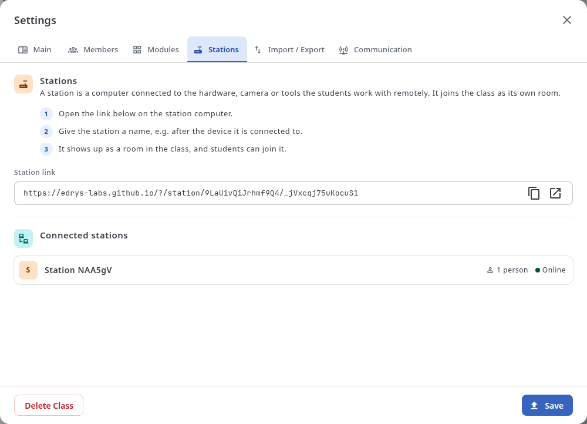

    --{{0}}--
The station appears as a separate room in the classroom, and students can interact with it by clicking on the room.
On the station itself, a `Station Mode Active` box shows its name. Type a new name and press the arrow button to rename it; `Exit Station Mode` opens the normal classroom link instead.
Every station also has its own user, which is shown in the room list. Changing the station name also changes this user name.
You can open multiple stations in parallel on different devices to make several hardware resources available.

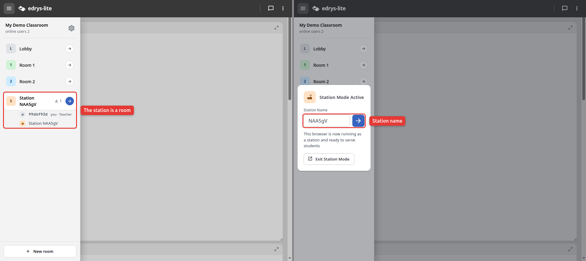

    --{{0}}--
A station keeps working while its tab is in the background, so the device can be used for other things in the meantime.
When the station tab is closed, its room disappears from the classroom after a few seconds and the students in it are moved back to the Lobby.
If the station only reloads, it comes back in the same room and the students stay.

### Example: Arduino Remote Lab

    --{{0}}--
An example use case of stations is a remote Arduino lab, where students can remotely interact with an Arduino (upload code to it and see the result through a camera) that is physically hosted somewhere else (e.g. on university grounds).
In this example, a university would like to give its students remote access to its fleet of lab devices, removing any need for students to be physically present to experiment with them.

    --{{1}}--
To achieve this, each Arduino is connected to a computer with internet access (in this example a Raspberry Pi), and a station is opened in each computer's browser.
We can use a USB webcam with the [Station-Stream](https://github.com/edrys-labs/module-streaming) module to let students see the Arduino, the [Code Editor](https://github.com/edrys-labs/module-monaco-editor) module to let students write code, and the [PyxTerm.js Terminal](https://github.com/edrys-labs/module-pyxtermjs) module to compile and upload it, which needs a small server running locally to connect the Arduino to the browser.

      {{1}}
1. [Station-Stream](https://github.com/edrys-labs/module-streaming)
2. [Code Editor](https://github.com/edrys-labs/module-monaco-editor)
3. [PyxTerm.js Terminal](https://github.com/edrys-labs/module-pyxtermjs)

    --{{2}}--
The overall setup for one station could look like this:

      {{2}}
<div align="center">
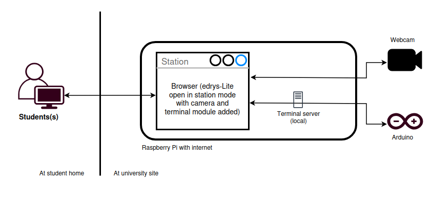
</div>

    --{{2}}--
Overall, this allows an easy setup of remote labs without configuring security, servers, port forwarding, or any other infrastructure.
All that is needed is a running browser, which can be repeated for any number of stations.
This produces a portable, scalable, and easy-to-share setup that can be replicated even by non-technical teachers.
The same principles apply to any other lab devices, since modules can be reused, combined, or developed to accommodate any setup.

### Tutorial: Build an Arduino Remote Lab

    --{{0}}--
In this tutorial you build the lab described above, step by step: students write code in the browser, press Execute, and the code is compiled and uploaded to a real Arduino Uno, while a camera shows the board.

<section>

**You need**

- an Arduino Uno with its USB cable
- a computer for the station that stays next to the board: Linux with [Docker](https://docs.docker.com/engine/install/) (Windows with WSL2 works too, see the [terminal module's README](https://github.com/edrys-labs/module-pyxtermjs))
- a USB webcam pointing at the board
- a second browser (or a private window) to test the lab as a student

**The plan**

| Module                                                               | Shown in | Job                                                  |
| -------------------------------------------------------------------- | -------- | ---------------------------------------------------- |
| [Markdown-IT](https://github.com/edrys-labs/module-markdown-it)      | Lobby    | explains the lab                                     |
| [Code Editor](https://github.com/edrys-labs/module-monaco-editor)    | Station  | students write the code and press Execute            |
| [Video Stream](https://github.com/edrys-labs/module-streaming)       | Station  | shows the board through the webcam                   |
| [PyxTerm.js Terminal](https://github.com/edrys-labs/module-pyxtermjs) | Station  | compiles and uploads the code, shows the serial output |

</section>

#### Step 1: Create the classroom

    --{{0}}--
Create a new classroom on https://edrys-labs.github.io (see [Creating a Classroom](#Creating-a-Classroom)).
Open `Settings` → `Main`, call it "Arduino Remote Lab", add a short description, and set the number of rooms to 0: students only need the Lobby and the station rooms.

#### Step 2: Describe the lab

    --{{0}}--
Open `Settings` → `Modules`. You can reuse the welcome guide that every new classroom starts with: click its settings button (the sliders icon). Its text is stored in the student and teacher fields of the form; clear both and write your instructions into the general field, which everyone sees. Keep `lobby` in its `Show in` field.

``` markdown
# Arduino Remote Lab

1. Click on a **Station** room in the menu on the left.
2. Change the code in the editor and press **Execute**.
3. The code is uploaded to the board. The camera shows the board,
   the terminal shows what it prints.
```

    --{{1}}--
The form has separate fields for everyone, for students and for teachers, so you can, for example, add setup notes that only teachers see.

#### Step 3: Add the code editor

    --{{0}}--
Click `Explore modules`, add the Code Editor (`module-monaco-editor`) and click its settings button.

<section>

- `runCommand`: `execute`. The editor sends the code under this name when someone presses Execute; the terminal listens for the same name.
- `language`: `cpp`
- `synchronize`: on, so everyone in the station room works on the same code
- `value`: the code students start with, for example:

``` cpp
void setup() {
  pinMode(LED_BUILTIN, OUTPUT);
  Serial.begin(9600);
}

void loop() {
  digitalWrite(LED_BUILTIN, HIGH);
  Serial.println("on");
  delay(1000);
  digitalWrite(LED_BUILTIN, LOW);
  Serial.println("off");
  delay(1000);
}
```

- `Show in` (under `Advanced (raw config)`): only the `Station` button

</section>

#### Step 4: Add the camera

    --{{0}}--
Add the Video Stream module (`module-streaming`). In its station settings, turn `video` on and `audio` off, and keep the method `webrtc`. Set `Show in` to `Station`.
The station shares its camera, and everyone who enters the station room sees it.

#### Step 5: Add the terminal

    --{{0}}--
Add the PyxTerm.js Terminal (`module-pyxtermjs`). It connects the station's browser to a small terminal server on the station computer, which does the actual compiling and uploading.

<section>

In its station settings:

- `server`: `http://localhost:5000/pty` (the default)
- `execute`: `execute`, the same name as the editor's `runCommand`
- `workflow`: `arduino-avr`. This preset fills in the board (`arduino:avr:uno`), the port (`/dev/ttyACM0`), the baud rate (`9600`) and the script that compiles, uploads and then shows the serial output. Change the board or port if yours differ.
- `enable`: tick `student` (and `teacher`). Without it, the station ignores code and keystrokes sent by students.
- `Show in`: `Station`


</section>

    --{{1}}--
Click `Save Configuration`, then `Save` in the settings. The classroom is now set up; all that is missing is a station.

#### Step 6: Prepare the station computer

    --{{0}}--
Plug the Arduino and the webcam into the station computer, then start the terminal server. The Docker image contains the Arduino tools and the board cores:

``` bash
docker run -it -p 127.0.0.1:5000:5000 \
  --device=/dev/ttyACM0:/dev/ttyACM0 \
  edryslabs/module-pyxtermjs:latest
```

    --{{1}}--
If your board is not on `/dev/ttyACM0`, check with `ls /dev/ttyACM* /dev/ttyUSB*` and change the command and the terminal's `port` setting accordingly. The board must be plugged in before you start the container.

#### Step 7: Open the station

    --{{0}}--
Open `Settings` → `Stations` and open the station link in a browser on the station computer (see [Opening a Station](#Opening-a-Station)). Allow access to the camera when the browser asks.
A new room `Station <name>` appears in the classroom and under `Connected stations`, showing the editor, the camera and the terminal. The terminal should report that it is connected.

#### Step 8: Test it as a student

    --{{0}}--
Open the classroom link in a second browser or a private window, so you join with a different User ID, as a student.
Click on the station room, change the code (for example the delay), and press Execute.
The terminal shows the compiler output and then the serial output, `on` and `off`, and the camera shows the LED blinking at the new speed.

#### Step 9: Share it

<section>

- Share the `Class link` from `Settings` → `Members` with your students (see [Inviting People](#Inviting-People)).
- For more boards, open the same station link on further computers, each with its own Arduino. Every station becomes its own room, so groups can work in parallel.
- Download a backup in `Settings` → `Import / Export`. The file can also serve as a template for other courses (see [Backup, Restore and Templates](#Backup%2C-Restore-and-Templates)).

</section>

    --{{0}}--
Ready-made labs like this one can be found at https://github.com/topics/edrys-lab.


## AI Agents and Skills

    --{{0}}--
AI agents such as Claude Code, GitHub Copilot or Cursor can help you build labs and modules, and they can answer your students' questions while they work.
All of this is optional: a classroom works exactly the same without it, and nothing is set up on the hosted edrys-lite.

<section>

| What                                                  | For                         | What it does                                                                                     |
| ----------------------------------------------------- | --------------------------- | ------------------------------------------------------------------------------------------------ |
| [Skills](#Skills-for-AI-Agents)                       | teachers, module developers | teach your agent how edrys-lite labs and modules are written                                     |
| [edrys-dev](#Building-a-Lab-with-edrys-dev)           | teachers                    | runs your lab file as a class on your computer, updated on every save                            |
| [Agent chat](#The-Agent-Chat-for-Teachers)            | teachers                    | talk to your agent from inside the class while it changes the lab                                |
| [Tutor](#The-Tutor-for-Students)                      | students                    | a tutor button in the class: an AI on the teacher's computer gives hints, not solutions          |

</section>

### Skills for AI Agents

    --{{0}}--
[Agent Skills](https://agentskills.io) are instructions and checks that an AI agent loads when a task needs them.
The [edrys skills](https://github.com/edrys-labs/skills) give an agent what it would otherwise not know about edrys-lite: which modules exist and how they are configured, how rooms and stations work, and the `edrys.js` API.

<section>

- **`edrys-lab`** builds and fixes classroom configurations from existing modules: it picks the modules, configures them per role, places them in the Lobby, rooms and stations, and checks the result. On request it creates a whole lab repository with a deploy button and the setup the station computer needs.
- **`edrys-module`** helps you write your own modules: the `edrys.js` API, the meta tags and settings form, messages, shared state and streams, a look that fits the classroom, tests and publishing.

</section>

    --{{0}}--
Install both into your agent with one command; it detects the agents on your computer (Claude Code, Copilot, Cursor, Gemini CLI and many more):

```bash
npx skills add edrys-labs/skills
```

    --{{1}}--
Then just describe what you need, for example:

<section>

- *"Build a remote lab for an Arduino Uno: students write code in an editor, it is compiled and uploaded at the station, and they watch the board through a webcam."*
- *"Students in my lab press Execute and nothing happens. Here is my classroom file."*
- *"Write an Edrys module where the teacher asks a question and students vote."*

</section>

    --{{1}}--
The agent writes a configuration file, which you load in `Settings` → `Import / Export` or publish with a deploy button (see [Backup, Restore and Templates](#Backup%2C-Restore-and-Templates)).

    --{{2}}--
On [claude.ai](https://claude.ai) the skills can be uploaded as ZIP files instead; the [skills README](https://github.com/edrys-labs/skills#claudeai-web-and-desktop-app) explains how.
Writing labs works there as well, but trying a module from a local server, testing with several browsers and setting up a station need an agent on your own computer.

    --{{2}}--
Agents still make mistakes, more often with several stations, new hardware or modules with shared state.
Load what the agent made in a real classroom with a second browser as a student before you use it in class, and read code before you run it at a station that controls real devices.

### Building a Lab with edrys-dev

    --{{0}}--
[edrys-dev](https://www.npmjs.com/package/@edryslabs/edrys-dev) runs edrys-lite on your own computer and keeps a class in step with a lab file: you write the lab in `lab.yml`, and every time you save it, the class updates in all open tabs.
It needs [Node.js](https://nodejs.org) 20 or newer.

```bash
npx @edryslabs/edrys-dev lab.yml --open
```

<section>

- **The `/?dev` tab is yours.** It is the teacher's view of the class and picks up your changes to `lab.yml`. Keep it open.
- **The file wins.** Changes made in the class's Settings are replaced the next time you save `lab.yml`, so make them in the file.
- **Students can join from their own computers** with the link edrys-dev prints after `students join at:`. It opens the class on https://edrys-labs.github.io, while your `/?dev` tab keeps following the file. Keep your tab open while they join.
- **Your own modules** go into a `modules/` folder next to the lab. edrys-dev serves them locally and reloads a module in the class when you save one of its files.

</section>

    --{{0}}--
When the lab is done, publish `lab.yml` the usual way, for example in a GitHub repository with a deploy link. Nothing from edrys-dev ends up in the file.
All options are listed in the [edrys-dev README](https://github.com/edrys-labs/edrys-devserver).

### The Agent Chat for Teachers

    --{{0}}--
edrys-dev can also work with your AI agent: the agent edits `lab.yml`, sees whether the class accepts it, and can look into the running class.
The quickest start is a new lab folder that is already set up for Claude Code and VS Code Copilot:

```bash
npx @edryslabs/edrys-dev init my-lab
```

    --{{0}}--
This creates `my-lab` with a starter `lab.yml`, the agent configuration and instructions, and offers to install the edrys skills.
Open the folder in your agent and write "start": the agent starts edrys-dev itself, so don't start it by hand as well.

    --{{1}}--
In your class tab, the button with the sparkles in the top bar opens the chat with your agent, on the right side of the class next to the class chat. Drag its left edge to make it wider.
Only you see this chat; it is not the class chat. The agent answers with text, and sometimes with buttons or checkboxes for you to pick from.
At the top, `Link for students` is the link to send to your class, with a `Copy` button.

      {{1}}
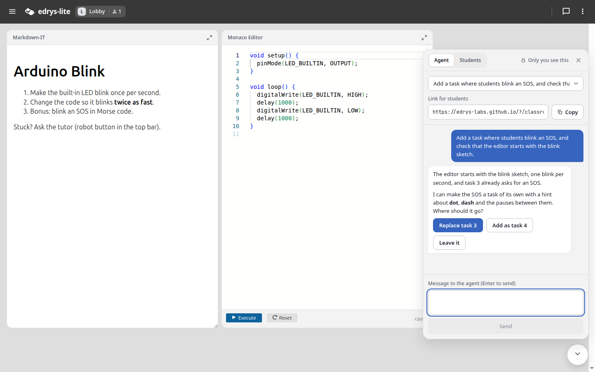

    --{{2}}--
While you talk, the agent can see what you see:

<section>

- the lab file, the rooms, who is in them and the modules,
- messages between modules and errors from your own modules,
- what the modules of a room share, for example the code in an editor,
- what students asked the tutor (see below), so it can tell you where they get stuck.

</section>

    --{{2}}--
It can also move your tab to a room or open a student or station tab to try the lab.
If the class cannot load your lab file, for example after a typing mistake, a red note in the chat says why.
Chats are saved in `.edrys-dev/chats/` next to the lab, and the menu at the top of the chat reopens older ones. Add `.edrys-dev/` to your `.gitignore`.

### The Tutor for Students

    --{{0}}--
With the tutor, students can ask an AI about the lab while they work. It is meant to help them get unstuck: it gives hints and explanations instead of whole solutions.

#### Asking the tutor

    --{{0}}--
If your teacher has switched the tutor on, the top bar of the class shows a button with a robot.
It opens the `Tutor` panel: type your question and press Enter.
The tutor knows the lab and sees what the modules of your room share, such as the code in the editor. It does not see your screen or a terminal's output, so paste error messages into your question.

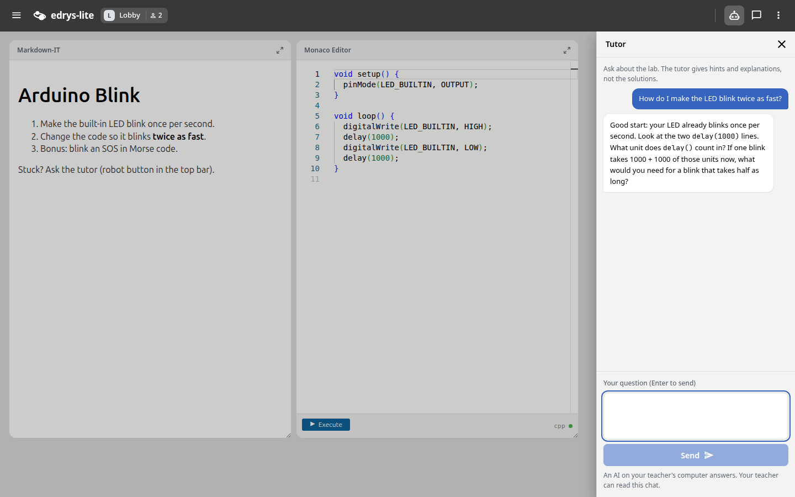

<section>

- An AI on your **teacher's computer** answers, and your teacher can read the conversation. Other students cannot.
- Your conversation continues with your next question, so you can ask follow-up questions.
- The button is only there while your teacher's class tab is open. If it disappears, ask your teacher.

</section>

#### Switching the tutor on

    --{{0}}--
The tutor is part of edrys-dev. Start it with `--tutor`, or create the lab folder with `init my-lab --tutor`.
Questions are answered by [Claude Code](https://claude.com/claude-code) on your computer, which must be installed and signed in; with `--tutor-agent codex`, [Codex](https://developers.openai.com/codex) answers instead.
Students need nothing but the class link.

```bash
npx @edryslabs/edrys-dev lab.yml --tutor
```

    --{{1}}--
In your class tab, the `Students` view of the agent chat (sparkles button) shows every question and answer as it happens.
The switch `Tutor answers students` turns the tutor off and on without a restart; while it is off, students can't use the tutor.

      {{1}}
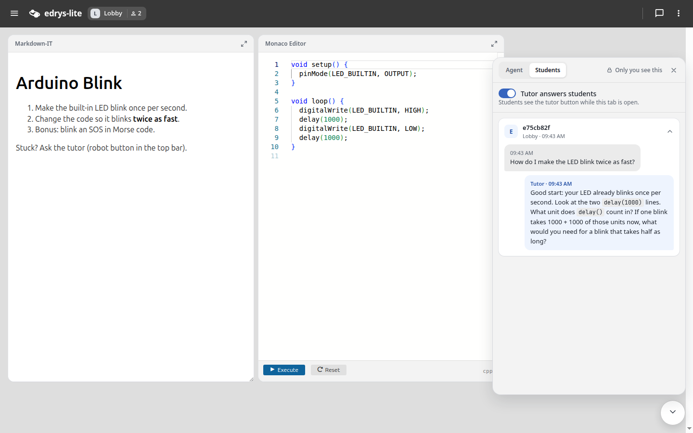

<section>

- **Notes for the tutor:** put a file `tutor.md` next to `lab.yml`, e.g. "Task 2 is about the delay() values, don't give the numbers". Students don't receive this file, but a student who tries hard may get the tutor to repeat it, so keep real secrets out of it.
- **It can only answer:** the tutor runs without tools, so a student cannot reach your files, your shell or the agent that edits your lab. It reads module state but cannot change it.
- **Limits:** each student can ask up to 20 questions an hour, the whole class up to 200 (`--tutor-per-hour` changes it).
- **Cost:** every answer uses the account that Claude Code or Codex is signed in to. Personal plans may not allow you to answer for others; for a class, start edrys-dev with an API key, which only the tutor uses:

  ```bash
  ANTHROPIC_API_KEY=sk-ant-... npx @edryslabs/edrys-dev lab.yml --tutor
  ```

- **Privacy:** students are told that an AI on your computer answers and that you can read the chat. Questions and answers are encrypted between the student's browser and your tab, so other members of the class and a WebSocket server that relays the class cannot read them.

</section>


## Privacy and Security

    --{{0}}--
edrys-lite works without user accounts and without a central server that stores your data. Instead, trust is built on the keys that every browser creates for its user.

<section>

- **No tracking:** There is no sign-up, no password, and no data collection. Classrooms are stored in the browsers of their participants.
- **Signed changes:** The classroom setup, the rooms, the chat and who is present are signed with the key of their author. Every participant's browser checks these signatures and ignores anything that was not signed by someone allowed to make that change.
- **Owner check:** The owner part of the classroom link lets a newcomer verify that the setup comes from the real owner.
- **Members list:** Only teachers can change the setup. If you list your students, nobody else can take part (see [Members](#Members)).
- **Safe content:** Chat messages and descriptions are shown as text, so they cannot run code in other people's browsers. Modules run isolated from the classroom page.
- **Tutor:** Only if a teacher switches it on, an AI on that teacher's computer answers students' questions. The conversation is encrypted between the student and the teacher's tab, and the teacher can read it (see [The Tutor for Students](#The-Tutor-for-Students)).

</section>

    --{{1}}--
Keep in mind that everyone who is allowed to work in a room can change the content of its modules, just as everyone in a real classroom can write on the whiteboard.


## Troubleshooting

<section>

**Others don't show up, or the classroom stays empty**

Your network probably blocks direct WebRTC connections. Switch to WebSocket in `Settings` → `Communication` and share the new link from that tab (see [Communication](#Communication)).

**A student cannot change anything**

The student is a visitor: the members list contains students, but not this one. Add their User ID, or empty the student list to let everyone in.

**A module does not appear in a room**

Check the `Show in` field of the module (see [Show in](#Show-in)). Room names must match as a whole: `Room 1` does not include `Room 10`.

**A station room disappeared**

The station tab was closed or its device lost its connection. Open the station link on the device again.

**My classroom is gone**

Classrooms are stored in the browser. A different browser, a private window, or cleared site data starts empty. Restore your classroom from a backup (see [Backup, Restore and Templates](#Backup%2C-Restore-and-Templates)).

**Students don't see the tutor button**

The tutor only works while the teacher's edrys-dev tab (`/?dev`) is open and the switch `Tutor answers students` is on (see [The Tutor for Students](#The-Tutor-for-Students)).

**The agent doesn't answer in the chat**

Check that your agent runs in the lab folder. Some agents don't notice new messages while they are idle; start the `chat` prompt of the edrys server once (in VS Code Copilot: `/edrys.chat`).

</section>


## How edrys-lite Works

    --{{0}}--
This section explains the technologies behind edrys-lite. You don't need to know them to use edrys-lite, but they help to understand why it works without a server.

### Principles and Technologies

    --{{0}}--
As you have seen, edrys-lite employs a modular approach where each module can be interconnected to facilitate interaction and communication among users.
Two mechanisms connect them: messages, which are sent directly to the other people in a room, and a shared state, which is kept in sync by Conflict-Free Replicated Data Types (CRDTs).
The participants' browsers are connected directly via WebRTC, or through a WebSocket relay where WebRTC is blocked.

### WebRTC Communication

>    --{{0}}--
> The Web Real-Time Communication is a free and open-source project providing web browsers and mobile applications with real-time communication (RTC) via application programming interfaces (APIs).
> It allows audio and video communication to work inside web pages by allowing direct peer-to-peer communication, eliminating the need to install plugins or download native apps...
> !?[](videos/edrys_05-0.webm)
>
> _Source: [Wikipedia](https://en.wikipedia.org/wiki/WebRTC)_


    {{0-1}}
``` ascii
                     (WebRTC)
Alice 👩‍💻 <------------------------------> 👨🏾‍💻 Bob
```

    --{{1}}--
But the entire process is actually a bit more complicated. At first, Alice initiates the WebRTC connection by generating an SDP offer that details her media capabilities, such as the types of audio and video streams she supports, along with the associated codecs and network parameters. This offer is then sent to the signaling server, which acts solely as a relay for connection setup information.
!?[](videos/edrys_05-1.webm)

    --{{2}}--
The signaling server receives Alice’s offer and forwards it to Bob. This intermediary role is crucial because it allows the initial exchange of connection data even when both parties are behind NATs or firewalls, ensuring that they can communicate the necessary parameters without directly connecting first.
!?[](videos/edrys_05-2.webm)

    --{{3}}--
After Bob receives Alice’s offer through the signaling server, he generates an SDP answer that outlines his media capabilities and confirms the proposed connection parameters. This answer provides a mutual understanding of the media exchange, indicating that Bob is ready to establish a connection and detailing his own network settings.
!?[](videos/edrys_05-3.webm)

    {{1}}
``` ascii
               (Signaling Server)

       .-------------> 🖥️ --------------.
       |    "{1}{}"   /  A      "{2}{}" |
       |             /    \             |
       |            /      \            V
                   /        \
Alice 👩‍💻 <--------'          '--------- 👨🏾‍💻 Bob
            "{4}{}"             "{3}{}"
      A                                  A
      |                                  |
      '----------------------------------'
      A    "{5}{Direct Communication}"   A
      |                                  |
      '-- - - - - - - - - - - - - - - - -'
             "{6}{InDirect via TURN}"
```

    --{{4}}--
The signaling server then relays Bob’s SDP answer back to Alice. This step completes the signaling handshake, allowing both peers to possess the required session descriptions that enable them to move forward with establishing a direct connection.
!?[](videos/edrys_05-4.webm)

    --{{5}}--
With the SDP offer and answer exchanged, Alice and Bob proceed with the ICE (Interactive Connectivity Establishment) process, wherein they gather potential network paths and perform connectivity checks. If successful, this process establishes a direct peer-to-peer connection that is optimized for low latency and secure real-time communication.
!?[](videos/edrys_05-5.webm)

    --{{6}}--
If the direct connection attempt fails due to restrictive NATs or firewalls, the process falls back to using a TURN server. In this case, the TURN server relays media traffic between Alice and Bob, ensuring that the communication remains uninterrupted, even though it might introduce a bit more latency compared to a direct connection.
!?[](videos/edrys_05-6.webm)


    {{7}}
> More confusing information on WebRTC:
>
>     --{{7}}--
> Simply listen to another explanation on YouTube:
> !?[](videos/edrys_05-7.webm)
>
> !?[WebRTC](https://www.youtube.com/watch?v=7cbD-hFkzY0)

    --{{7}}--
In edrys-lite, the connections between participants carry data, not audio or video: the classroom state, messages and presence travel over WebRTC data channels. Only camera streams of modules use WebRTC media connections, which are set up separately by the streaming module.
A TURN server is only used if one is configured; you can add your own in [Communication](#Communication).

    --{{7}}--
If WebRTC is blocked entirely, a classroom can use a WebSocket server instead (see [Communication](#Communication)). The server then relays the messages between the participants, but the signatures described in [Privacy and Security](#Privacy-and-Security) are still checked by every browser.

### State Synchronization

    --{{0}}--
A _**C**onflict-free **R**eplicated **D**ata **T**ype_ (CRDT) is a new type of data structure[^1] that can be replicated across multiple instances in a network with the following guarantees:
!?[](videos/edrys_06-0.webm)

    {{1}}
1. A replica can be updated independently, concurrently and without coordinating with other replicas.
2. Inconsistencies can be resolved automatically.
3. Although replicas may have different state, they are guaranteed to eventually converge.

    --{{1}}--
CRDTs allow each replica to be updated independently and concurrently without needing to coordinate with other replicas, meaning that changes can be made even when devices are disconnected or operating in parallel. Any inconsistencies that arise from these independent updates are automatically resolved by the system, ensuring that differences are managed seamlessly. Even though replicas might temporarily have different states, the underlying design guarantees that they will eventually converge to a consistent state once all updates are shared.
!?[](videos/edrys_06-1.webm)


      {{2}}
__Task:__ Implement a distributed counter

    --{{2}}--
The following example is used only as an illustration of the problem that CRDTs solve. In practice, CRDTs are used to implement more complex data structures, such as sets, maps, and lists, that can be replicated across multiple devices in a network.
!?[](videos/edrys_06-2.webm)

    --{{3}}--
In this distributed counter, both Alice and Bob start with a value of 0. Bob first adds 5 to his counter, and his update is transmitted to Alice so that her counter also reflects a value of 5. Next, Alice increments her counter by 1, raising her local value to 6; however, if this update fails to reach Bob, he remains unaware of the change and retains his previous value of 5. Later, when Bob adds 2 to his counter, his value increases to 7, creating a divergence between the two replicas. The conceptual problem here is that without the reliability and conflict-resolution guarantees provided by CRDTs, lost messages—like Alice’s +1—result in inconsistent states, as the replicas no longer converge on a single, agreed-upon counter value.
!?[](videos/edrys_06-3.webm)

    {{3}}
``` ascii
Alice 👩‍💻

[0]---------*-->[5]--[+1 = 6]--------*-->[8]-- - - - - - - - - - - - 
           /            \           /          \
          A              V         A            \
         /                        /              \
[0]---[+5 = 5]-----------------[+2 = 7]-- - - - --*- - - - - - - - - -

Bob 👨🏾‍💻
```

    {{4}}
__Solution:__ Let every replica count its own part...

    --{{4}}--
How can the same problem be solved for a network with messages losses, fluctuating users and no central authority.
!?[](videos/edrys_06-4.webm)

    --{{5}}--
In this CRDT-based approach, every replica only ever changes its own entry: the total of everything it has added itself. Alice starts with (a,0) and Bob with (b,0); Bob's +5 makes his entry (b,5), Alice's +1 makes hers (a,1), and Bob's +2 makes his (b,7).
Instead of single increments, each message carries the sender's complete state. A receiver merges it by keeping, for every entry, the larger value, and the counter's value is the sum of all entries.
If a message is lost, like Alice's (a,1), the next one she sends contains it again. Merging the same state twice changes nothing, and the order of messages does not matter, so both replicas converge on the same value, here 1 + 7 = 8.

    {{5}}
``` ascii
Alice 👩‍💻

{(a,0)}----------*-->{(a,0),(b,5)}->{(a,1),(b,5)}---*-->{(a,1),(b,7)}
                /                         \        /   
               A                           V      A   
              /                                  /
{(b,0)}---{(b,5)}----------------------------{(b,7)}-----------------

Bob 👨🏾‍💻
```

    {{6}}
<section>

__Implementations__

   --{{6}}--
There are several libraries and frameworks that provide CRDT implementations for various data structures, including sets, maps, and lists. We use Yjs, a popular CRDT library that offers shared maps, arrays and text, and that does not depend on a particular network: edrys-lite synchronizes it over WebRTC or WebSocket.


- [Automerge](https://automerge.org)
- [__Yjs__](https://docs.yjs.dev)

</section>


[^1]: The CRDT concept was defined in 2011 by Marc Shapiro, Nuno Preguiça, Carlos Baquero and Marek Zawirski.

      See also: https://en.wikipedia.org/wiki/Conflict-free_replicated_data_type

### How edrys-lite Puts It Together

    --{{0}}--
Every classroom is one shared Yjs document, of which every participant's browser holds a full copy. Besides it, edrys-lite uses two kinds of information that are not stored.

<section>

| What                  | How it is shared                                                                                     | Kept?                                       |
| --------------------- | ---------------------------------------------------------------------------------------------------- | ------------------------------------------- |
| Classroom setup       | Yjs document, signed by the owner or a teacher                                                       | yes, in every participant's browser         |
| Rooms and module state | Yjs document, one shared map per room (what modules store with `Edrys.getState`)                    | yes                                         |
| Chat                  | Yjs document, every message signed by its author                                                     | yes                                         |
| Who is present, and where | Yjs _Awareness_: short-lived, signed entries that every browser renews regularly               | no, an entry disappears when its user leaves |
| Module messages       | sent directly to each person in the room, signed for sender, room and addressee                     | no                                          |

</section>

    --{{1}}--
Because every browser holds the whole document, a classroom keeps working as long as one participant is online, and newcomers receive it from whoever is there.
There is no server that could decide what is correct, so every browser checks the signatures itself and ignores what was not signed by someone allowed to make that change (see [Privacy and Security](#Privacy-and-Security)).


## Developing Modules

    --{{0}}--
Edrys labs are based on the concept of "modules".
A module is a classroom/lab building block.
You can create your own modules or explore existing modules and add them to your classroom.

    --{{1}}--
A module is just an HTML page that is run in an iframe and shown to your students, teachers, and on stations.
You can make the module behave differently depending on where it is currently loaded.
Modules use the Edrys.js library to send and receive messages in real time, allowing you to build any live functionality without setting up any real-time infrastructure, authenticating users, or configuring anything else, as that is all handled upstream by Edrys.

      {{1}}
<!-- data-marker="14 0 14 200 log" -->
``` html
<!DOCTYPE html>
<html lang="en">
  <head>
    <meta charset="UTF-8" />
    <meta http-equiv="X-UA-Compatible" content="IE=edge" />
    <meta name="viewport" content="width=device-width, initial-scale=1.0" />

    <meta
      name="description"
      content="A reference module to help with development"
    />
    <meta name="show-in" content="*" />
    <title>Reference Module</title>

    <script src="https://edrys-labs.github.io/module/edrys.js"></script>
    <link rel="stylesheet" href="https://edrys-labs.github.io/module/vendor/water.min.css" />
    <link rel="stylesheet" href="https://edrys-labs.github.io/module/edrys-module.css" />
   ...
```

    --{{1}}--
The two stylesheets give the module the classroom's look, in its light or dark theme (see [Styling](#Styling)).

    --{{2}}--
You can also inspect the reference module, which is a good starting point for developing your own modules.
It shows how to use the edrys.js library and how to interact with the environment to send and receive messages, update the state.

      {{2}}
https://github.com/edrys-labs/module-reference/blob/main/index.html


    --{{3}}--
You can also explore existing ready-to-use modules, check out the:

      {{3}}
[`edrys-module` tag on GitHub](https://github.com/topics/edrys-module).

    --{{3}}--
If you work with an AI agent, install the `edrys-module` skill (see [Skills for AI Agents](#Skills-for-AI-Agents)), and try your module with [edrys-dev](#Building-a-Lab-with-edrys-dev), which reloads it in the class whenever you save.

    --{{3}}--
A module only accepts messages from the edrys-lite page that embeds it. Messages that other windows post to it, such as frames the module opens itself, are ignored by edrys.js.


### `edrys.js`

    --{{0}}--
The Edrys JavaScript client library provides an interface to interact with Edrys live classrooms.
It includes reactive properties and various functions to manage messaging, updates, and local storage.

#### Properties

    {{1}}
<section>

##### `Edrys.ready`

__Boolean indicating if Edrys is initialized.__

    --{{1}}--
This boolean property indicates whether the Edrys system has finished initializing and is fully prepared to manage module interactions, ensuring that all functionalities are available before executing module-specific operations.

```js
console.log(Edrys.ready); // true or false
```

---

</section>

    {{2}}
<section>

##### `Edrys.role`

__User role within the classroom.__

    --{{2}}--
This property specifies the current user's role within the classroom environment -- whether they are a teacher, student, or station -- enabling the system and modules to adapt their behavior based on the user's access level and responsibilities.

```js
console.log(Edrys.role); // "teacher", "student", or "station"
```

---

</section>

    {{3}}
<section>

##### `Edrys.username`

__The ID of the current user.__

    --{{3}}--
This property holds the identifier of the current user in the classroom. It is the key under which the user is listed in `Edrys.liveClass.users`, and the value you pass to `Edrys.sendMessage` to address a single user.


```js
// Current user's ID
console.log(Edrys.username);
```

---

</section>

    {{4}}
<section>

##### `Edrys.module`

__Users of the module can pass in some run-time configuration to your module to customize its behavior.__

    --{{4}}--
This object contains the runtime configuration for a module, including general settings and role-specific options (for students, teachers, or stations), allowing the module to adjust its behavior dynamically based on the context in which it is used.

```js
// Always available
console.log(Edrys.module.config);
// Only available when this module is loaded to a student
console.log(Edrys.module.studentConfig);
// Only available when this module is loaded to a teacher
console.log(Edrys.module.teacherConfig);
// Only available when this module is loaded on a station
console.log(Edrys.module.stationConfig);
```

---

</section>

    {{5}}
<section>

##### `Edrys.liveClass`

__Reactive object representing the live classroom state.__

    --{{5}}--
This reactive state object represents the overall classroom environment by providing real-time information about the users who are currently present and the available rooms, which enables modules to update and respond dynamically as the classroom state changes. It is read-only: Edrys replaces it with a fresh snapshot on every update, so read it inside `Edrys.onUpdate` rather than keeping a reference, and use `Edrys.getState` to share data. The same applies to `Edrys.liveRoom` and `Edrys.liveUser`.

```js
// Users currently present in the classroom, keyed by their ID:
// { "<id>": { displayName, room, role }, ... }
console.log(Edrys.liveClass.users);
// Rooms of the classroom, keyed by room name, each with the shared
// state of its modules: { "Lobby": { ... }, "Room 1": { ... }, ... }
console.log(Edrys.liveClass.rooms);
```

---

</section>

    {{6}}
<section>

##### `Edrys.liveRoom`

__Reactive object representing the live room state.__

    --{{6}}--
This reactive object holds the shared state of the current room, i.e. everything the modules in this room stored with `Edrys.getState`, as a plain object. It does not contain the room's name; that is `Edrys.liveUser.room`.

```js
// Shared state of the current room, keyed by state key
console.log(Edrys.liveRoom);
// Name of the current room
console.log(Edrys.liveUser.room);
```

---

</section>

    {{7}}
<section>

##### `Edrys.liveUser`

__Reactive object representing the live user state.__

    --{{7}}--
This reactive state object stores personalized data about the current user, such as their display name and the room they are occupying. It can be undefined for a moment while the user is joining, so check it before use.

```js
// User's display name
console.log(Edrys.liveUser?.displayName);
// User's current room
console.log(Edrys.liveUser?.room);
// User's role: "teacher", "student" or "station"
console.log(Edrys.liveUser?.role);
```

---

</section>

    {{8}}
<section>

##### `Edrys.debug`

__Enable or disable debug messages in the console.__

    --{{8}}--
This flag enables or disables the logging of debug messages to the console, assisting developers by providing real-time diagnostic information to help troubleshoot and monitor the internal operations of the system.

```js
// Import the debug function to log messages (instead of console.log, console.warn, etc)
const dbg = Edrys.importDebug();
// Disable debug messages (or true to enable them)
Edrys.debug = false;
// Log a debug message
dbg('Survey Module Ready');
```

---

</section>

    {{9}}
<section>

##### `Edrys.class_id`

__The ID of the classroom.__

    --{{9}}--
This property holds the unique ID of the classroom the module is loaded in, the same ID that appears in the classroom link. Use it to tell classrooms apart, for example as part of a key when your module stores data outside of edrys.

```js
console.log(Edrys.class_id);
```

---

</section>

    {{10}}
<section>

##### `Edrys.theme`

__The classroom's theme: `"light"` or `"dark"`.__

    --{{10}}--
This property holds the theme the user picked in the classroom's menu (or that their system picked, with `System`). edrys.js also puts it on the module's page as `<html data-theme="light">` or `"dark"`, which is what `edrys-module.css` follows.

```js
console.log(Edrys.theme); // "light" or "dark"
console.log(document.documentElement.dataset.theme); // the same
```

</section>

#### Event Handling

    --{{0}}--
The Event Handling section details how modules can register callback functions to respond to important system events.
These methods let you execute custom code when the Edrys system is fully initialized or when any real-time state updates occur, ensuring that your module remains synchronized with the dynamic classroom environment.

      {{1}}
<section>

##### `Edrys.onReady(handler)`

__Register a handler to be called when Edrys is ready.__

    --{{1}}--
This method allows you to register a callback function that will be executed once the Edrys system has fully loaded and is ready to handle module interactions. The handler runs only once, so it is the right place for one-time setup such as creating an editor.

```javascript
Edrys.onReady(() => console.log("Module is loaded!"));
```

</section>

      {{2}}
<section>

##### `Edrys.onUpdate(handler)`

__Register a handler to be called on any real-time state changes.__

    --{{2}}--
This function enables you to set up a callback that will be triggered on any real-time state changes within the classroom environment, allowing your module to respond dynamically to updates as they occur.

```javascript
Edrys.onUpdate(() => console.log("Module is updated!"));
```

</section>

      {{3}}
<section>

##### `Edrys.onTheme(handler)`

__Register a handler to be called when the classroom's theme changes.__

    --{{3}}--
The handler receives the new theme, `"light"` or `"dark"`, the first time with the first update and then whenever the user switches the theme. It returns a function that removes the handler.
CSS that uses the `--edrys-*` variables switches by itself; only code that sets colours in JavaScript, such as an editor or terminal theme, a chart or a canvas, needs this handler.

```javascript
const color = (name) =>
  getComputedStyle(document.documentElement).getPropertyValue(name).trim();

function applyTheme() {
  // e.g. rebuild an editor theme from the classroom's colours
  chart.options.color = color("--edrys-text");
  chart.update();
}

applyTheme();
const stop = Edrys.onTheme?.(applyTheme);
```

</section>

#### Messaging

    --{{0}}--
Modules can send and receive messages in real time.
Messages are sent to a specific user only or to all users in __the same room__.
Every message is signed for its sender, room and addressee, so a received message really comes from the user in `from`, and messages from visitors are not delivered.

      {{1}}
<section>

##### `Edrys.sendMessage(subject, body, user?)`

    --{{1}}--
This method enables modules to send messages in real time by specifying a subject and a body. The body, which can be of any type, is automatically handled through serialization and deserialization, ensuring smooth data exchange. Optionally, you can target a specific user by providing their identifier, otherwise the message is broadcast to all users in the same room.

- Sends a message with the given subject and body.
- The body can be of any type, this will be automatically serialized and deserialized by using [msgpackr](https://github.com/kriszyp/msgpackr).
- user(optional): the user to send the message to, this is the `from` field when receiving the message with the `onMessage` handler.

```javascript
Edrys.sendMessage("subject", "body");
```

---

</section>

      {{2}}
<section>

##### `Edrys.onMessage(handler, promiscuous?)`

    --{{2}}--
This function allows you to register a callback that listens for incoming messages. The handler receives an object with the sender’s details, the subject, and the message body whenever a new message is received. By setting the promiscuous flag to true, the handler can capture all messages in the room, while leaving it false limits the scope to messages intended specifically for the current module.

- Registers a handler for receiving messages.
- `handler({ from, subject, body })`: Called when a message is received.
- `promiscuous`: If true, listens to all messages in the room; otherwise, only listens to messages sent by the same module (same module URL).
- Returns a function that removes the handler again.

``` javascript
const stop = Edrys.onMessage(({ from, subject, body }) => {
  console.log("Got new message: ", from, subject, body);
});

// later: stop listening
stop();
```

</section>

#### Local Storage

    --{{0}}--
Modules can store data locally to persist state across sessions within the browser.

    {{1}}
<section>

##### `Edrys.setItem(key, value)`

__Stores a value in local storage, scoped to the current class and user room.__

    --{{1}}--
This method allows modules to save data locally within the browser, storing a specific value under a given key. The data is scoped to the current class and user room, ensuring that the information persists across sessions and remains isolated within the appropriate context.

``` javascript
Edrys.setItem("key", "value");
```

---

</section>

    {{2}}
<section>

##### `Edrys.getItem(key)`

__Retrieves a stored value from local storage.__

    --{{2}}--
This function retrieves data that was previously stored in local storage using the specified key. It enables modules to access persisted state across browser sessions, ensuring a consistent experience for users within the same classroom and room context.

```javascript
Edrys.getItem("key");
```

</section>

#### State Management

    --{{0}}--
Edrys.js initializes by listening to message events from its parent frame and sets up reactive state management using Yjs.
It therefore uses the same datatypes as Yjs.
The state is kept per room: every room has its own copy, shared by everyone in it.

Yjs documentation: https://docs.yjs.dev/api/shared-types

    {{1}}
<section>

##### `Edrys.getState(key?, type?, value?)`

    --{{1}}--
This method retrieves or initializes a reactive state entry using Yjs data structures, such as Map, Array, or Value, enabling modules to share and synchronize state across clients.

- Retrieves or initializes a state entry.
- type: Can be one of `Map`, `Array`, `Text`, `XmlFragment`, `XmlText`, `XmlElement`, `Value`, or `Awareness`.
- If type is Value, an optional value can be provided: with a value the entry is set, without one the current value is returned.
- Without a key, the whole state of the current room is returned (a `Y.Map`).

```javascript
const state = Edrys.getState("key", "Map");

// set two values in the map
state.set('option1', 12)
state.set('option2', [12 , 22, true])

// get the value of option1
console.log(state.get('option1')) // 12

// get the entire map
console.log(state.toJSON())
// Object { option1: 12, option2: [12, 22, true] }
```

---

</section>

    {{2}}
<section>

##### Awareness (cursors and presence)

    --{{2}}--
With the type `Awareness`, `getState` returns a Yjs [Awareness](https://docs.yjs.dev/api/about-awareness) object for the current room and key.
Awareness is meant for short-lived information that should not be stored, such as cursors, selections or who is currently typing. Editor bindings like `y-monaco` or `y-codemirror` accept it directly.

- Call it from within `Edrys.onReady()`; before that it throws.
- Each room and key has its own awareness, so the cursors of different editors or rooms don't mix.
- A user's states are removed automatically when they leave the room or the module is reloaded.

```javascript
Edrys.onReady(() => {
  const text = Edrys.getState("code", "Text");
  const awareness = Edrys.getState("code", "Awareness");

  awareness.setLocalStateField("user", {
    name: Edrys.liveUser?.displayName,
    color: "#ff8800",
  });

  awareness.on("change", () => {
    // everyone's state in this room, keyed by client id
    console.log(awareness.getStates());
  });

  // e.g. new MonacoBinding(text, editor.getModel(), new Set([editor]), awareness)
});
```

---

</section>

    {{3}}
<section>

##### `Edrys.updateState(transaction : () => {})`

    --{{3}}--
Since every state update will trigger the `Edrys.onUpdate` handler, this function batches multiple state updates into a single transaction, ensuring that changes are applied together and trigger only one update event, thereby improving performance and consistency.

```javascript
const state = Edrys.getState("key", "Map");

Edrys.updateState(() => {
  state.set('option1', 12)
  state.set('option2', [12 , 22, true])
  state.set('option3', "a string")
});
```

---

</section>

    {{4}}
<section>

##### `Edrys.clearState(key)`

__Removes a state entry from the current room.__

    --{{4}}--
This method removes a specific state entry from the current room, effectively clearing any persisted data associated with the given key and keeping the reactive state clean.

```javascript
Edrys.clearState("key");
```

</section>

#### Streaming

    --{{0}}--
A module can also share a stream of data. This can be used to share video, audio... with other users in the room.

    {{1}}
Streams can be shared by either using WebRTC or WebSockets. It is recommended to use WebRTC for real-time streaming, as it provides better performance and lower latency.
WebRTC streams use the STUN/TURN servers configured for the classroom.
If WebRTC is not available, you can use a WebSocket relay as a fallback.

    {{2}}
Only members in the station's room receive a stream: a viewer is connected only after it asked for the stream through a signed edrys message, and a WebSocket stream uses a random relay room that is handed out the same way.

    {{3}}
<section>

##### `Edrys.sendStream(stream, options?)`

__Sends a stream to all users in the room.__

    --{{3}}--
This method transmits a media stream, such as video or audio, to all connected users in the current room.
You can configure the streaming method and WebSocket URL through the optional options parameter.

- `options.method`: `"webrtc"` (default) or `"websocket"`.
- `options.websocketUrl`: the relay server, for `"websocket"`.
- `options.streamName`: tells several streams of one station apart; defaults to `stationConfig.streamName`. Without one, a `"webrtc"` stream is named `"<username>-stream"` and a `"websocket"` stream `"Camera 1"`, while `onStream` looks for `"Camera 1"`: set the same name on both sides.
- `options.peerServerConfig`: a custom PeerJS server for `"webrtc"`; defaults to `stationConfig.peerServerConfig`.
- Resolves to `{ stop(), updateStream(newStream) }`.

```javascript
navigator.mediaDevices
    .getUserMedia(constraints)
    .then(async (stream) => {
      videoElement.srcObject = stream;
      videoElement.autoplay = true;
      loaderElement.classList.add("hidden");

      currentStream = await Edrys.sendStream(stream, {
        method: streamMethod,
        websocketUrl: websocketUrl,
      });
    })
```

---

</section>

    {{4}}
<section>

##### `Edrys.onStream(handler, options?)`

__Registers a handler for receiving streams.__

    --{{4}}--
This function registers a callback to handle incoming media streams from other users in the room.
The handler receives the stream object and associated settings when a new stream is received, allowing your module to process, display, or manipulate the incoming media content.

- `handler(stream, settings, metadata)`: `settings` is the station's `stationConfig`, `metadata` is `{ streamName, room }`.
- `options`: the same `method`, `websocketUrl`, `streamName` and `peerServerConfig` as for `sendStream`; both sides must use the same method and stream name.
- Resolves to `{ stop() }`.

```javascript
Edrys.onStream((stream, settings) => {
    videoElement.srcObject = stream;
    applyVideoTransform(videoElement, settings);
}, {
    method: streamMethod,
    websocketUrl: websocketUrl,
}).then((stream) => {
    currentStream = stream;
});
```

</section>

### Metadata

    --{{0}}--
Edrys scrapes module HTML files for metadata. It looks at meta tags in your HTML
and stores this information. The following meta tags can be set:

- `title`: \
  the page title tag will be used as the module name

- `description`: \
  module description that will be shown to people adding your module.
  It is shown as plain text: line breaks (`<br>`) and `http(s)` links (`<a href="...">`) are kept, all other HTML is removed.

- `show-in`: \
  defines where the module will be shown by default.
  It accepts the same entries as the `Show in` field of the module settings (see [Show in](#Show-in)), e.g. `*`, `lobby`, `station` or room names.

- `fetch`: \
  this cannot be used for every module, but it allows to fetch the index.html directly without the need of hosting.
  This is especially useful for modules that might change in the future, but you want to have a stable version.
  Hence, you can use the URL to a tagged version on GitHub, which will not destroy other experiments if the module configuration changes.
  Such modules are inlined and run on a `data:` URL, i.e. with an opaque origin.

  Checkout the Markdown-It module on: https://github.com/edrys-labs/module-markdown-it

- `module-config`: \
    a JSON object that is passed to edrys which will then create a simple form to configure the module.
    The form fields are dynamically generated based on the schema provided. An example of a schema can be found in the [Markdown-It module (html head)](https://github.com/edrys-labs/module-markdown-it/blob/main/index.html#L15).

#### Module Configuration Schema

    --{{0}}--
The schema has one entry per configuration type (`config`, `studentConfig`, `teacherConfig`, `stationConfig`), each listing its fields.
Every field has a `type`, and optionally a `hint` shown below it and a `default` value. The default is what the form starts with, so the form never saves a value the module would not use by itself.

| Type | Field Created |
|------|---------------|
| `boolean` | Checkbox |
| `checkboxes` | Group of checkboxes, one per entry in `options` |
| `radio-button` | Radio button group, one per entry in `options` |
| `select` | Drop-down list of `options`; may carry `presets` (see below) |
| `combobox` | Drop-down list of suggested `options` that also accepts free text |
| `number` | Number input field |
| `text-area` | Multi-line text area |
| `date` | Date picker |
| `color` | Color picker |
| `code-area` | Markdown editor |
| Default (`string`) | Single-line text input field |

    --{{0}}--
A `select` field can define `presets`: for each option, the values to fill into sibling fields of the same configuration type.
An entry is either a plain value, or an object with `value` and `options` that also narrows the suggestions of a `combobox`.
Picking an option overwrites these fields, even if they were edited by hand.

```json
{
  "stationConfig": {
    "workflow": {
      "type": "select",
      "options": ["arduino-avr", "micropython"],
      "hint": "Pick a board family to fill in the fields below",
      "presets": {
        "arduino-avr": {
          "board": {
            "value": "arduino:avr:uno",
            "options": ["arduino:avr:uno", "arduino:avr:mega"]
          },
          "port": "/dev/ttyACM0",
          "baud": 9600
        },
        "micropython": {
          "port": "auto",
          "baud": 115200
        }
      }
    },
    "board": { "type": "combobox", "options": ["arduino:avr:uno", "esp32:esp32:esp32"] },
    "port": { "type": "string" },
    "baud": { "type": "number", "default": 9600 }
  }
}
```


### Styling

    --{{0}}--
A lab is made of several modules, often from different authors. To make them look like one tool, the edrys-labs modules share one look, in the classroom's light or dark theme.
Your module gets it from two stylesheets, linked after `edrys.js` and before your own CSS:

```html
<script src="https://edrys-labs.github.io/module/edrys.js"></script>
<link rel="stylesheet" href="https://edrys-labs.github.io/module/vendor/water.min.css" />
<link rel="stylesheet" href="https://edrys-labs.github.io/module/edrys-module.css" />
```

    --{{0}}--
[water.css](https://watercss.kognise.dev) styles plain HTML. `edrys-module.css` sets its colours from the classroom's theme, the fonts (Noto Sans, and JetBrains Mono for code), and a few parts for the module's layout.

#### Colours

    --{{0}}--
Take colours from the `--edrys-*` variables instead of writing hex values; then your CSS switches with the theme by itself.

<section>

| Use                                | Variables                                                                                       |
| ---------------------------------- | ----------------------------------------------------------------------------------------------- |
| page, text, headings, muted text   | `--edrys-bg`, `--edrys-text`, `--edrys-heading`, `--edrys-muted`                                |
| buttons, main action, fields       | `--edrys-button`, `--edrys-primary`, `--edrys-on-primary`, `--edrys-field`, `--edrys-field-line` |
| status                             | `--edrys-ok`, `--edrys-warn`, `--edrys-error`, and the pill colours `--edrys-ok-pill` etc.       |
| code and editors                   | `--edrys-code-bg`, `--edrys-code-text`, `--edrys-keyword`, `--edrys-number`, `--edrys-selection` |
| terminals (dark in both themes)    | `--edrys-terminal`, `--edrys-on-terminal`                                                       |
| fonts                              | `--edrys-font`, `--edrys-mono`                                                                  |

</section>

    --{{0}}--
The full list is at the top of [edrys-module.css](https://github.com/edrys-labs/edrys-lite/blob/main/static/module/edrys-module.css).
JavaScript reads them with `getComputedStyle(document.documentElement).getPropertyValue("--edrys-bg")`, and re-applies them in [`Edrys.onTheme`](#Event-Handling).

#### Layout

    --{{0}}--
Modules that show a status or have controls put them in the same places:

```html
<header class="edrys-toolbar">
  <span id="status" class="edrys-pill ok" role="status">Connected</span>
  <span class="edrys-spacer"></span>
  <label for="baud">Baud rate</label>
  <select id="baud">…</select>
</header>
<main>…</main>
<footer class="edrys-footer">
  <button class="primary" id="run">Run</button>
</footer>
```

<section>

- **No title in the module.** The frame around it already shows the module's name.
- **`.edrys-toolbar`** at the top: the status on the left, `.edrys-spacer`, then secondary actions and settings.
- **`.edrys-pill`** for the status: `ok` (connected, running), `warn` (connecting, waiting), `error` (failed), or no class for idle.
- **`.edrys-footer`** at the bottom for the main actions, the primary one first as `button.primary`.
- **`.edrys-terminal`** for terminal output; terminals stay dark in both themes.
- **Fill the tile.** Modules can be small or large and are resizable; avoid fixed widths and horizontal scrolling.

</section>

    --{{1}}--
Content modules, such as a text or slides, skip the toolbar and footer.
The `edrys-module` skill for AI agents (see [Skills for AI Agents](#Skills-for-AI-Agents)) contains the full design guide, including how to theme Monaco, xterm, CodeMirror and chart libraries, and good example modules to copy from: [module-reference](https://github.com/edrys-labs/module-reference), [module-serial](https://github.com/edrys-labs/module-serial) and [module-survey](https://github.com/edrys-labs/module-survey).

### YAML-Modules

    --{{0}}--
To simplify the development of small modules, a module can also be declared in a single YAML file instead of an HTML page.
Edrys fetches the file and builds the HTML page from it.
A URL is treated as a YAML module if it ends in `.yml` or `.yaml`.

    --{{1}}--
The keys mirror the meta tags of an HTML module. With `load` you list the scripts and stylesheets to include, `style` holds the CSS, `body` the HTML of the page, and `main` the JavaScript that runs in it.

      {{1}}
``` yaml
name: Hello Edrys                      # module name (like <title>)
description: Greets everyone in the room. See <a href="https://github.com/edrys-labs">edrys-labs</a>
icon: mdi-hand-wave                    # optional, a Material Design icon name
show-in:                               # optional, a list; default is '*'
  - lobby
  - Room *

module-config: |-                      # optional, same schema as the meta tag, as a string
  {
    "config": {
      "greeting": { "type": "string", "default": "Hello" }
    }
  }

load:
  scripts:                             # loaded in this order
    - https://edrys-labs.github.io/module/edrys.js
    - lib/helpers.js                   # relative to the YAML file
  links:
    - https://edrys-labs.github.io/module/vendor/water.min.css
    - https://edrys-labs.github.io/module/edrys-module.css

style: |-
  body { margin: 0; padding: 16px 18px; max-width: none; }
  #greeting { font-size: 1.5rem; color: var(--edrys-heading); }

body: |-
  <p id="greeting">Loading…</p>

main: |-
  Edrys.onReady(() => {
    const greeting = Edrys.module.config?.greeting || "Hello"
    document.getElementById("greeting").textContent =
      `${greeting}, ${Edrys.liveUser?.displayName}!`
  })
```

    --{{2}}--
A complete real-world example is the Markdown-It module, which is available both as an HTML page and as a YAML file.

      {{2}}
<section>

- https://github.com/edrys-labs/module-markdown-it/blob/main/module.yaml

**Good to know**

- Absolute URLs in `load` are included as normal `<script>` and `<link>` tags. Relative ones are resolved against the URL of the YAML file, fetched, and then added to the page.
- Like modules with the `fetch` meta tag, YAML modules are inlined: they run on a `data:` URL with an opaque origin. The browser's `localStorage` is not available there, and therefore neither are `Edrys.setItem` and `Edrys.getItem`. Use `Edrys.getState` to keep state.
- The `description` is shown as text with links, like that of an HTML module (see [Metadata](#Metadata)).

</section>


## Reporting Issues

    --{{0}}--
Found a bug, or missing a feature? Please let us know. Check the [Troubleshooting](#Troubleshooting) section first, and search the existing issues, maybe someone already reported it.

<section>

**Where to report**

| The problem is in ...                       | Report it at                                                                                   |
| ------------------------------------------- | ---------------------------------------------------------------------------------------------- |
| edrys-lite itself (classroom, settings, connection, stations) | [edrys-lite issues](https://github.com/edrys-labs/edrys-lite/issues)      |
| a single module (editor, terminal, stream, ...) | the issues of that module's repository, linked in its description and at https://github.com/topics/edrys-module |
| this documentation                          | [documentation issues](https://github.com/edrys-labs/documentation/issues)                     |

</section>

    --{{0}}--
A good report lets us reproduce the problem. Please include:

<section>

- **What you did** step by step, what you expected, and what happened instead
- **Browser and system**, e.g. Firefox 131 on Windows 11, or Chrome on a Raspberry Pi
- **Your role** (teacher, student, station) and whether a station was involved
- **The connection method**, WebRTC or WebSocket (see `Settings` → `Communication`), and whether you are on a school or company network
- **Error messages** from the browser console: press `F12` (or `Cmd+Option+I` on a Mac), open the `Console` tab, and copy the red entries
- **Screenshots or a short screen recording**, if the problem is visible
- For problems with a lab, the **classroom configuration** from `Settings` → `Import / Export`. The file contains no keys or signatures, so it is safe to attach.

</section>

    --{{0}}--
Please don't post your classroom link in a public issue if the classroom is meant for your students only: anyone with the link can join it, unless you have listed your students as members.
